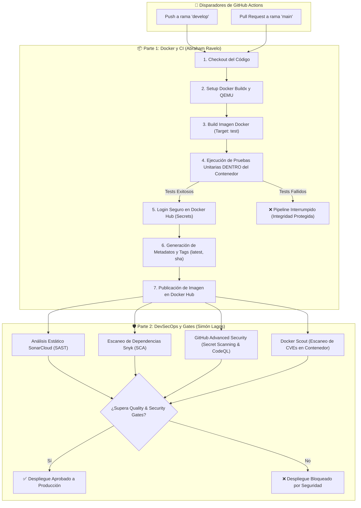

# Evaluación Parcial N° 3: Aseguramiento de la Calidad del Software con GitHub y GitHub Actions

**Asignatura:** AUY1102 - Ciclo de vida del Software I  
**Institución:** Duoc UC - Escuela de Informática y Telecomunicaciones  
**Ponderación:** 40% (100 puntos)  
**Organización de GitHub:** [grupo-4duoc](https://github.com/grupo-4duoc)  
**Repositorio de Entrega:** [grupo-4duoc/AUY1102-Pipelineparcial3](https://github.com/grupo-4duoc/AUY1102-Pipelineparcial3) (Público)

---

## 👥 Equipo de Trabajo y Distribución de Responsabilidades

| Estudiante | Rol / Parte Asignada | Responsabilidades Principales |
| :--- | :--- | :--- |
| **Abraham Ravelo** | **Parte 1:** Automatización con GitHub Actions y Docker | • Creación y optimización de `Dockerfile` multi-stage.<br>• Pipeline de CI/CD para build de imágenes Docker.<br>• Ejecución de pruebas unitarias **dentro** del contenedor.<br>• Publicación automática a Docker Hub con credenciales seguras.<br>• Configuración de eventos y ramas (`develop` y `main`). |
| **Simón Lagos** | **Parte 2:** Análisis de Código y Seguridad (DevSecOps) | • Integración de SonarCloud para análisis estático (SAST).<br>• Integración de Snyk para vulnerabilidades en dependencias.<br>• Configuración de GitHub Advanced Security (GHAS / Secret Scanning / CodeQL).<br>• Escaneo de imágenes con Docker Scout.<br>• Configuración de Quality & Security Gates. |

---

## 📐 1. Arquitectura del Pipeline de CI/CD

El pipeline implementa una estrategia de integración y entrega continua (CI/CD) con mentalidad **DevSecOps**, asegurando que ninguna versión de software llegue a producción sin haber validado su funcionalidad, calidad y seguridad.



---

## 🐳 2. Detalle de Implementación: Parte 1 (Abraham Ravelo)

### 2.1. Dockerfile Multi-Etapa (`Dockerfile`)
Se diseñó un `Dockerfile` optimizado siguiendo las mejores prácticas de la industria y consideraciones éticas de seguridad:

1. **Etapa 1 (`builder`):** Basada en `node:18-alpine` para minimizar el tamaño de la imagen y reducir la superficie de ataque frente a vulnerabilidades. Instala todas las dependencias necesarias (`npm ci` o `npm install`) y compila el proyecto TypeScript generando los artefactos en `dist/`.
2. **Etapa 2 (`test`):** Diseñada específicamente para la ejecución de pruebas unitarias dentro del entorno aislado del contenedor (`npm run test:unit`).
3. **Etapa 3 (`production`):** Contiene únicamente las dependencias de producción (`npm ci --only=production`) y los archivos compilados en `dist/`. Además, incorpora la instrucción **`USER node`** para evitar la ejecución del contenedor como usuario `root` (principio ético de mínimo privilegio).

### 2.2. Archivo `.dockerignore`
Se configuró para excluir archivos sensibles y temporales:
- `node_modules` (evita conflictos de arquitectura).
- `credentials.yml` (garantiza que secretos nunca queden embebidos en las capas de Docker).
- `.git`, `.github`, `coverage` y documentación.

### 2.3. Pipeline en GitHub Actions (`.github/workflows/ci-docker.yml`)
El flujo automatiza de extremo a extremo:
- **Disparadores específicos:**
  - `push` a la rama `develop`.
  - `pull_request` a la rama `main`.
  - `workflow_dispatch` (ejecución manual).
- **Ejecución de pruebas dentro del contenedor:**
  ```bash
  docker build --target test -t auy1102-pipeline:test .
  docker run --rm auy1102-pipeline:test npm run test:unit
  ```
  Si alguna prueba falla, el contenedor retorna un código de salida distinto de 0 y GitHub Actions interrumpe el flujo, impidiendo que código defectuoso se publique.
- **Publicación a Docker Hub:**
  - Se utiliza `docker/login-action@v3` autenticando mediante variables de entorno seguras (`DOCKERHUB_USERNAME` y `DOCKERHUB_TOKEN`).
  - La imagen se etiqueta dinámicamente con `latest`, el hash corto del commit (`sha`) y la rama correspondiente.
  - La imagen queda disponible en: `https://hub.docker.com/r/araveloo/auy1102-pipeline`.

---

## 🛡️ 3. Detalle de Implementación: Parte 2 (Simón Lagos)

### 3.1. SonarCloud (Análisis Estático de Código - SAST)
- Archivo de configuración: `sonar-project.properties`.
- Analiza calidad, duplicaciones de código, malas prácticas (*code smells*) y cobertura de pruebas sobre el directorio `src/`.

### 3.2. Snyk (Escaneo de Dependencias y Librerías)
- Monitorea vulnerabilidades en librerías de terceros declaradas en `package.json` y `package-lock.json`.

### 3.3. GitHub Advanced Security (GHAS)
- **Secret Scanning:** Detección automática de tokens y credenciales expuestas (e.g. `credentials.yml`).
- **CodeQL:** Análisis semántico de patrones inseguros en código TypeScript.
- **Dependabot:** Detección de dependencias desactualizadas o con alertas de seguridad.

### 3.4. Docker Scout
- Analiza la imagen compilada capa por capa, identificando CVEs (Common Vulnerabilities and Exposures) en los paquetes de Alpine y dependencias.

### 3.5. Quality & Security Gates
- Regla de interrupción automática: si se detectan vulnerabilidades de severidad `CRITICAL` o `HIGH`, el pipeline falla y rechaza la integración a `main`.

---

## 📋 4. Matriz de Cumplimiento de la Rúbrica de Evaluación

| Indicador de Evaluación | Ponderación | Aspecto Evaluado | Cómo se cumple en el Proyecto |
| :--- | :---: | :--- | :--- |
| **IE4.1.1** | **33%** | Reconoce componentes de CI/CD, manteniendo integridad del código y respetando consideraciones éticas. | • Uso de `USER node` en Dockerfile (principio de menor privilegio).<br>• Secretos protegidos en GitHub Secrets (sin hardcoding de credenciales).<br>• Archivo `.dockerignore` previniendo fuga de información.<br>• Integridad garantizada mediante pruebas unitarias previas al push. |
| **IE4.2.1** | **33%** | Diseña pipelines de CI/CD, garantizando calidad y entrega continua para compilación, prueba y despliegue ágil. | • Definición clara de triggers para `develop` (desarrollo ágil) y `main` (despliegue productivo).<br>• Flujo multi-etapa con targets independientes de test y producción.<br>• Versionamiento automático por tags y commit SHA. |
| **IE4.3.1** | **34%** | Implementa pipelines de CI/CD para automatizar compilación, prueba y despliegue de software en desarrollo ágil. | • Workflow `.github/workflows/ci-docker.yml` completamente operativo.<br>• Ejecución real de tests unitarios dentro del contenedor Docker.<br>• Publicación automática y funcional en Docker Hub (`araveloo/auy1102-pipeline`). |

---

## 🛠️ 5. Guía de Ejecución y Pruebas Locales

### Prerrequisitos
- Node.js >= 18.x
- Docker Engine / Docker Desktop

### Comandos de Construcción y Prueba
```bash
# 1. Clonar el repositorio
git clone https://github.com/grupo-4duoc/AUY1102-Pipelineparcial3.git
cd AUY1102-Pipelineparcial3

# 2. Construir la imagen Docker para pruebas
docker build --target test -t auy1102-pipeline:test .

# 3. Ejecutar las pruebas unitarias DENTRO del contenedor
docker run --rm auy1102-pipeline:test npm run test:unit

# 4. Construir la imagen final de producción
docker build --target production -t auy1102-pipeline:prod .

# 5. Ejecutar la aplicación en contenedor
docker run -d -p 3000:3000 --name auy1102-app auy1102-pipeline:prod
```

---

## 📸 6. Registro de Evidencias de Ejecución

### Evidencia 1: Construcción y Pruebas en Contenedor (GitHub Actions)
*(Aquí se incluye la captura de pantalla de la ejecución exitosa del job `ci-cd-docker` en GitHub Actions mostrando la salida verde de las pruebas unitarias)*.

### Evidencia 2: Publicación en Docker Hub
*(Aquí se incluye la captura de pantalla del repositorio público `araveloo/auy1102-pipeline` en Docker Hub con la etiqueta `latest` y el SHA correspondiente)*.

### Evidencia 3: Análisis de Seguridad y Quality Gates
*(Aquí se incluyen las evidencias de la Parte 2: SonarCloud, Snyk, GitHub Advanced Security y Docker Scout)*.
