# Evaluación Parcial N° 3: Aseguramiento de la Calidad del Software con GitHub y GitHub Actions

**Asignatura:** AUY1102 - Ciclo de vida del Software I  
**Institución:** Duoc UC - Escuela de Informática y Telecomunicaciones  
**Ponderación:** 40% (100 puntos)  
**Organización de GitHub:** [grupo-4duoc](https://github.com/grupo-4duoc)  
**Repositorio de Entrega:** [grupo-4duoc/AUY1102-Pipelineparcial3](https://github.com/grupo-4duoc/AUY1102-Pipelineparcial3) (Público)

---

## 📝 Resumen Ejecutivo

Este proyecto implementa un pipeline **DevSecOps** en GitHub Actions que construye la aplicación TypeScript en Docker, ejecuta las pruebas unitarias dentro del contenedor y publica la imagen en Docker Hub. Antes de publicar, el código y la imagen deben superar **gates de calidad y seguridad**: SonarCloud (Quality Gate), Snyk (dependencias y código), GitHub Advanced Security (CodeQL, Dependency Review y escaneo de secretos con Gitleaks) y Docker Scout (CVEs de la imagen). Si **cualquier gate falla, la imagen no se publica** y un Ruleset impide integrar el Pull Request a `main`. El funcionamiento se demostró con evidencias en dos fases: primero el **bloqueo** del pipeline ante código inseguro, secretos expuestos y vulnerabilidades intencionales (sección 7), y luego la **remediación** de cada hallazgo hasta obtener el pipeline aprobado y la imagen publicada (secciones 8 y 9).

---

## 👥 Equipo de Trabajo y Distribución de Responsabilidades

| Estudiante | Rol / Parte Asignada | Responsabilidades Principales |
| :--- | :--- | :--- |
| **Abraham Ravelo** | **Parte 1:** Automatización con GitHub Actions y Docker | • Creación y optimización de `Dockerfile` multi-stage.<br>• Pipeline de CI/CD para build de imágenes Docker.<br>• Ejecución de pruebas unitarias **dentro** del contenedor.<br>• Publicación automática a Docker Hub con credenciales seguras.<br>• Configuración de eventos y ramas (`develop` y `main`). |
| **Simón Lagos** | **Parte 2:** Análisis de Código y Seguridad (DevSecOps) | • Integración de SonarCloud para análisis estático (SAST).<br>• Integración de Snyk para vulnerabilidades en dependencias.<br>• Configuración de GitHub Advanced Security (GHAS / Secret Scanning / CodeQL).<br>• Escaneo de imágenes con Docker Scout.<br>• Configuración de Quality & Security Gates. |

---

## 📐 1. Arquitectura del Pipeline de CI/CD

El pipeline implementa una estrategia de integración y entrega continua (CI/CD) con mentalidad **DevSecOps**, asegurando que ninguna versión de software llegue a producción sin haber validado su funcionalidad, calidad y seguridad.

Los **gates de calidad y seguridad se ejecutan ANTES de publicar**. El job `Publicar en Docker Hub` declara `needs` hacia todos los demás jobs: si cualquiera falla, la imagen **no se publica**. Además, la publicación solo ocurre en `push` a `develop` (o ejecución manual); en un Pull Request a `main` se ejecutan todos los gates, pero no se publica.

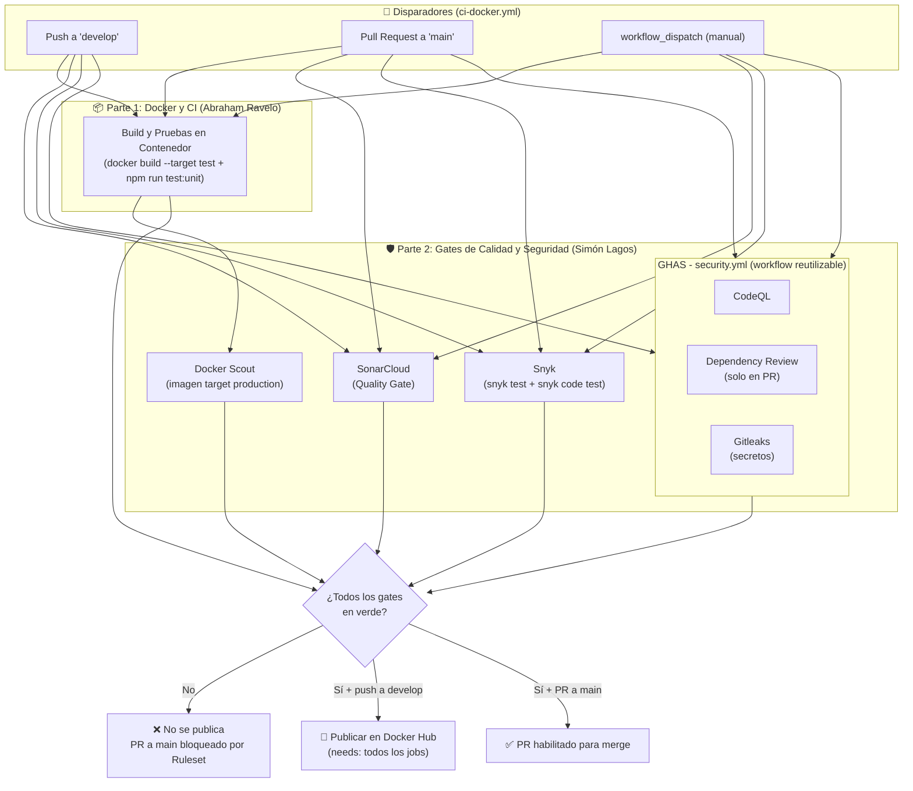

---

## 🐳 2. Detalle de Implementación: Parte 1 (Abraham Ravelo)

### 2.1. Dockerfile Multi-Etapa (`Dockerfile`)
Se diseñó un `Dockerfile` optimizado siguiendo las mejores prácticas de la industria y consideraciones éticas de seguridad:

1. **Etapa 1 (`builder`):** Basada en `node:22-alpine` para minimizar el tamaño de la imagen y reducir la superficie de ataque frente a vulnerabilidades. Instala todas las dependencias necesarias (`npm ci --ignore-scripts`) y compila el proyecto TypeScript generando los artefactos en `dist/`.
2. **Etapa 2 (`test`):** Diseñada específicamente para la ejecución de pruebas unitarias dentro del entorno aislado del contenedor (`npm run test:unit`).
3. **Etapa 3 (`production`):** Basada en `node:22-alpine`. Contiene únicamente las dependencias de producción (`npm ci --omit=dev --ignore-scripts`) y los archivos compilados en `dist/`. Además, incorpora la instrucción **`USER node`** para evitar la ejecución del contenedor como usuario `root` (principio ético de mínimo privilegio).

### 2.2. Archivo `.dockerignore`
Se configuró para excluir archivos sensibles y temporales:
- `node_modules` (evita conflictos de arquitectura).
- `credentials.yml` (garantiza que secretos nunca queden embebidos en las capas de Docker).
- `.git`, `.github`, `coverage` y documentación.

### 2.3. Pipeline en GitHub Actions (`.github/workflows/ci-docker.yml`)
El flujo automatiza de extremo a extremo:
- **Disparadores específicos:**
  - `push` a la rama `develop`.
  - `pull_request` a la rama `main`.
  - `workflow_dispatch` (ejecución manual).
- **Ejecución de pruebas dentro del contenedor:**
  ```bash
  docker build --target test -t auy1102-pipeline:test .
  docker run --rm auy1102-pipeline:test npm run test:unit
  ```
  Si alguna prueba falla, el contenedor retorna un código de salida distinto de 0 y GitHub Actions interrumpe el flujo, impidiendo que código defectuoso se publique.
- **Publicación a Docker Hub:**
  - Se utiliza `docker/login-action@v3` autenticando mediante variables de entorno seguras (`DOCKERHUB_USERNAME` y `DOCKERHUB_TOKEN`).
  - La imagen se etiqueta dinámicamente con `latest`, el hash corto del commit (`sha`) y la rama correspondiente.
  - La imagen queda disponible en: `https://hub.docker.com/r/araveloo/auy1102-pipeline`.

---

## 🛡️ 3. Detalle de Implementación: Parte 2 (Simón Lagos)

La Parte 2 convierte el pipeline de la Parte 1 en un pipeline **DevSecOps con gates**: cada herramienta de calidad o seguridad es un job independiente que debe terminar en verde para que la imagen se publique en Docker Hub y para que un Pull Request pueda integrarse a `main`.

### 3.1. Archivos de la Parte 2

| Archivo | Propósito |
| :--- | :--- |
| `.github/workflows/ci-docker.yml` | Pipeline principal. Se dispara con `push` a `develop`, `pull_request` a `main` y `workflow_dispatch`. Contiene los jobs de build/pruebas, SonarCloud, Snyk, GHAS, Docker Scout y la publicación con `needs` hacia todos. |
| `.github/workflows/security.yml` | Workflow **reutilizable** (`on: workflow_call`) con los controles de GitHub Advanced Security: CodeQL, Dependency Review y escaneo de secretos con Gitleaks. Se invoca desde el job `ghas` de `ci-docker.yml`. |
| `sonar-project.properties` | Configuración de SonarCloud: organización `sinnada`, proyecto `sinnada_AUY1102-Pipelineparcial3`, código en `src/`, pruebas en `test/` y cobertura desde `coverage/lcov.info`. |
| `.github/dependabot.yml` | Actualizaciones automáticas de dependencias para **npm**, **docker** (imagen base del `Dockerfile`) y **github-actions**, con PRs dirigidos a `develop`. |

Los workflows originales de la plantilla (`codeql.yml`, `pull_request.yml` y `reusable-workflow.yml`) se conservaron como **legado**: se actualizaron (Node 22, actions v4, CodeQL v4) y quedaron solo con `workflow_dispatch`, para no duplicar análisis con el pipeline principal.

### 3.2. Jobs del pipeline: qué analizan y cuándo fallan

| Job (check en GitHub) | Herramienta | Qué analiza | Cuándo falla (gate) |
| :--- | :--- | :--- | :--- |
| `Build y Pruebas en Contenedor` | Docker + Jest | Construye la imagen `target: test` y ejecuta `npm run test:unit` dentro del contenedor (Parte 1). | Si alguna prueba unitaria falla. |
| `SonarCloud (Quality Gate)` | SonarCloud (`SonarSource/sonarqube-scan-action` v6) | Calidad del código (bugs, vulnerabilidades, *code smells*, duplicación) y **cobertura** de pruebas generada con `npm run test:coverage`. | Si el Quality Gate **"Sonar way"** queda en *Failed* (por ejemplo, cobertura < 80% en código nuevo o issues de seguridad). Se usa `-Dsonar.qualitygate.wait=true` para que el job espere el veredicto. |
| `Snyk (dependencias y código)` | Snyk (`snyk/actions/node`) | **SCA:** `snyk test` revisa las librerías de `package.json`/`package-lock.json`. **SAST:** `snyk code test` revisa el código fuente. | Si cualquiera de los dos encuentra hallazgos de severidad **high o critical** (`--severity-threshold=high`). |
| `GHAS / CodeQL (javascript-typescript)` | CodeQL (`github/codeql-action@v4`, consultas `security-extended`) | Análisis semántico del código TypeScript (inyecciones, XSS, logging de datos sensibles, etc.). Publica las alertas en *Security → Code scanning*. | Un paso propio lee el SARIF y falla si hay hallazgos con `security-severity >= 7.0` (**high/critical**). |
| `GHAS / Dependency Review` | `actions/dependency-review-action@v4` | Compara las dependencias que **agrega o modifica** un Pull Request contra la rama destino. Solo corre en `pull_request`. | Si el PR introduce una dependencia con vulnerabilidad **high o superior** (`fail-on-severity: high`). |
| `GHAS / Escaneo de secretos (Gitleaks)` | Gitleaks (imagen Docker oficial) | Busca tokens, API keys y credenciales en los archivos del repositorio. Complementa el *Secret Scanning* y *Push Protection* nativos de GitHub. | Si encuentra al menos un secreto (`--exit-code 1`). |
| `Docker Scout (imagen production)` | `docker/scout-action` | Construye la imagen `target: production` (sin publicarla) y analiza los CVEs de sus paquetes de sistema y de Node.js. | Si existen CVEs **critical o high con arreglo disponible** (`only-severities: critical,high`, `only-fixed: true`, `exit-code: true`). |
| `Publicar en Docker Hub` | `docker/build-push-action` | Publica la imagen `production` con tags `latest`, `sha-xxxxxxx` y nombre de rama. | Tiene `needs` hacia **todos** los jobs anteriores: si uno falla, este job se omite. Solo se ejecuta en `push` a `develop` o manualmente. |

### 3.3. Dependabot
Además de abrir PRs de actualización, Dependabot genera **alertas** en *Security → Dependabot* cuando una dependencia del `package-lock.json` tiene una vulnerabilidad conocida. Se amplió su configuración a los ecosistemas `docker` y `github-actions` para mantener actualizada la imagen base y las versiones de las actions.

### 3.4. Protección de la rama `main` (Ruleset)
Se creó el Ruleset **`proteger-main`** (Settings → Rules → Rulesets) sobre la rama `main`, que exige Pull Request y los **7 checks** del pipeline como *required status checks*:

1. `Build y Pruebas en Contenedor`
2. `SonarCloud (Quality Gate)`
3. `Snyk (dependencias y código)`
4. `Docker Scout (imagen production)`
5. `GHAS / CodeQL (javascript-typescript)`
6. `GHAS / Escaneo de secretos (Gitleaks)`
7. `GHAS / Dependency Review`

Con esto, un Pull Request con problemas de calidad o seguridad **no se puede mergear** a `main`.

### 3.5. Secrets utilizados
| Secret | Uso |
| :--- | :--- |
| `SONAR_TOKEN` | Autenticación con SonarCloud. |
| `SNYK_TOKEN` | Autenticación con Snyk. |
| `DOCKERHUB_USERNAME` | Usuario de Docker Hub (Docker Scout y publicación). |
| `DOCKERHUB_TOKEN` | Access token de Docker Hub (Read & Write). |

Se eliminó el usuario de respaldo hardcodeado del pipeline original: la publicación usa **exclusivamente** los secrets del repositorio y falla explícitamente si no están configurados.

---

## 📋 4. Matriz de Cumplimiento de la Rúbrica de Evaluación

| Indicador de Evaluación | Ponderación | Aspecto Evaluado | Cómo se cumple en el Proyecto |
| :--- | :---: | :--- | :--- |
| **IE4.1.1** | **33%** | Reconoce componentes de CI/CD, manteniendo integridad del código y respetando consideraciones éticas. | • Uso de `USER node` en Dockerfile (principio de menor privilegio).<br>• Secretos protegidos en GitHub Secrets (sin hardcoding de credenciales).<br>• Archivo `.dockerignore` previniendo fuga de información.<br>• Integridad garantizada mediante pruebas unitarias previas al push. |
| **IE4.2.1** | **33%** | Diseña pipelines de CI/CD, garantizando calidad y entrega continua para compilación, prueba y despliegue ágil. | • Definición clara de triggers para `develop` (desarrollo ágil) y `main` (despliegue productivo).<br>• Flujo multi-etapa con targets independientes de test y producción.<br>• Versionamiento automático por tags y commit SHA. |
| **IE4.3.1** | **34%** | Implementa pipelines de CI/CD para automatizar compilación, prueba y despliegue de software en desarrollo ágil. | • Workflow `.github/workflows/ci-docker.yml` completamente operativo.<br>• Ejecución real de tests unitarios dentro del contenedor Docker.<br>• Publicación automática y funcional en Docker Hub (`araveloo/auy1102-pipeline`). |

---

## 🛠️ 5. Guía de Ejecución y Pruebas Locales

### Prerrequisitos
- Node.js >= 22.x
- Docker Engine / Docker Desktop

### Comandos de Construcción y Prueba
```bash
# 1. Clonar el repositorio
git clone https://github.com/grupo-4duoc/AUY1102-Pipelineparcial3.git
cd AUY1102-Pipelineparcial3

# 2. Construir la imagen Docker para pruebas
docker build --target test -t auy1102-pipeline:test .

# 3. Ejecutar las pruebas unitarias DENTRO del contenedor
docker run --rm auy1102-pipeline:test npm run test:unit

# 4. Construir la imagen final de producción
docker build --target production -t auy1102-pipeline:prod .

# 5. Ejecutar la aplicación en contenedor
docker run -d -p 3000:3000 --name auy1102-app auy1102-pipeline:prod
```

---

## 📸 6. Registro de Evidencias de Ejecución (Parte 1 - Abraham Ravelo)

### 6.1. Evidencia 1: Construcción y Pruebas Unitarias DENTRO del Contenedor en GitHub Actions
Ejecución exitosa del workflow `CI/CD Pipeline - Docker y Pruebas Unitarias (Parte 1 - Abraham Ravelo)` (Run #4). Se evidencia la compilación de TypeScript y la ejecución de las **10 suites de prueba y 18 pruebas unitarias** pasando al 100% dentro del contenedor Docker aislado:

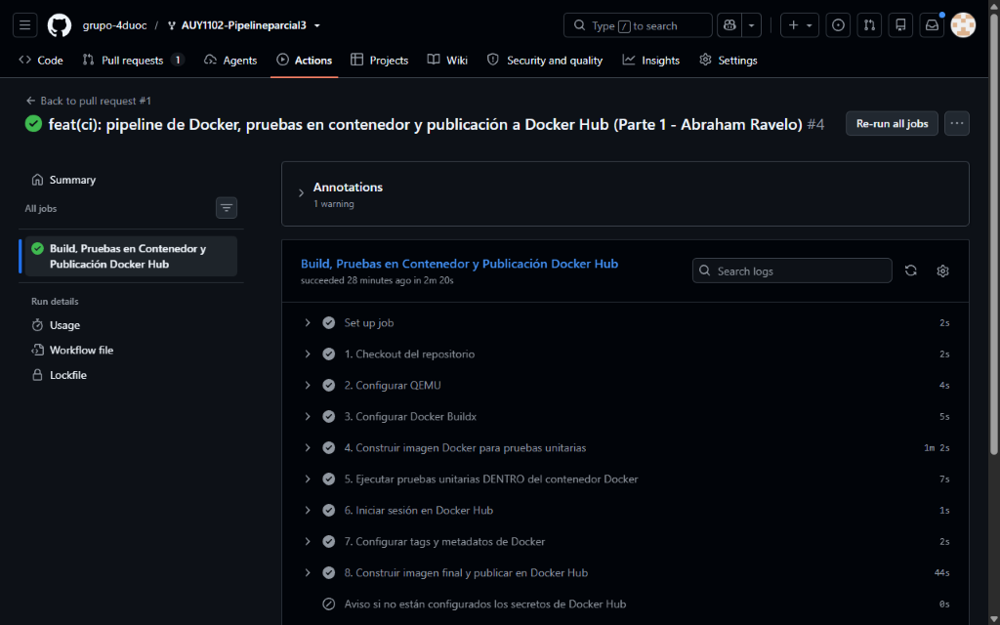

---

### 6.2. Evidencia 2: Publicación Automática en Docker Hub
Visualización del repositorio público [`araveloo/auy1102-pipeline`](https://hub.docker.com/r/araveloo/auy1102-pipeline) en Docker Hub, con las imágenes publicadas bajo la arquitectura `linux/amd64` (45.34 MB) y las etiquetas automáticas generadas por el pipeline:
- `latest`
- `develop`
- `sha-004d93c`

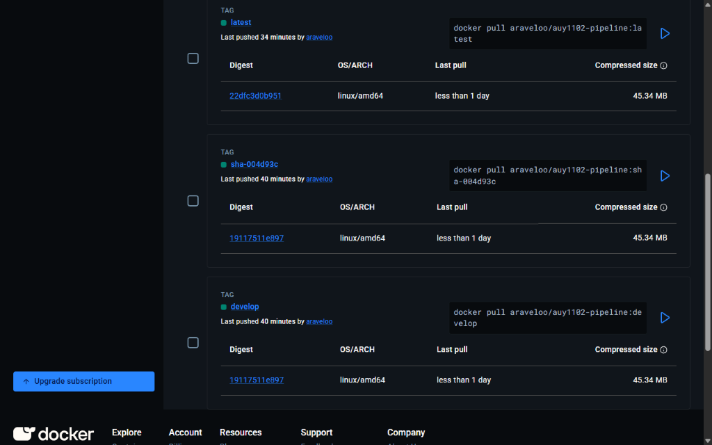

---

### 6.3. Evidencia 3: Pull Request a `main` con Verificación de Checks (All Checks Passed)
Vista del [Pull Request #1 (`develop` → `main`)](https://github.com/grupo-4duoc/AUY1102-Pipelineparcial3/pull/1). Se comprueba el cumplimiento del requisito de activación en Pull Requests a la rama `main`, mostrando **"All checks have passed" (2/2 checks exitosos)**:

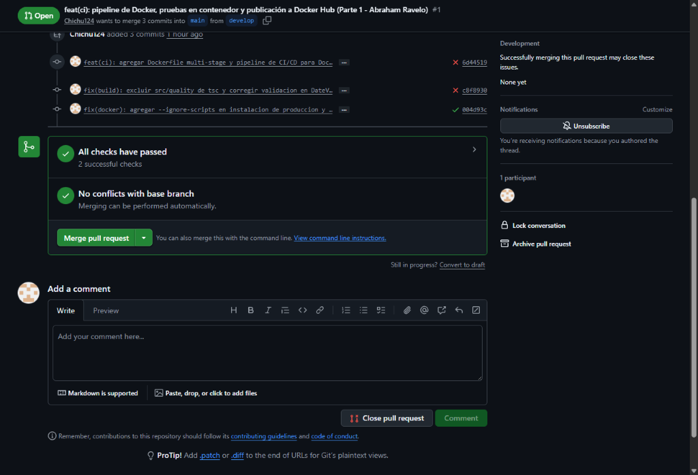

---

### 6.4. Evidencia 4: Gestión Ética y Segura de Credenciales (GitHub Secrets)
Configuración de secretos en el repositorio (`DOCKERHUB_USERNAME` y `DOCKERHUB_TOKEN`), garantizando el resguardo de accesos y la ausencia de contraseñas en texto plano dentro del código fuente (principio ético de seguridad):

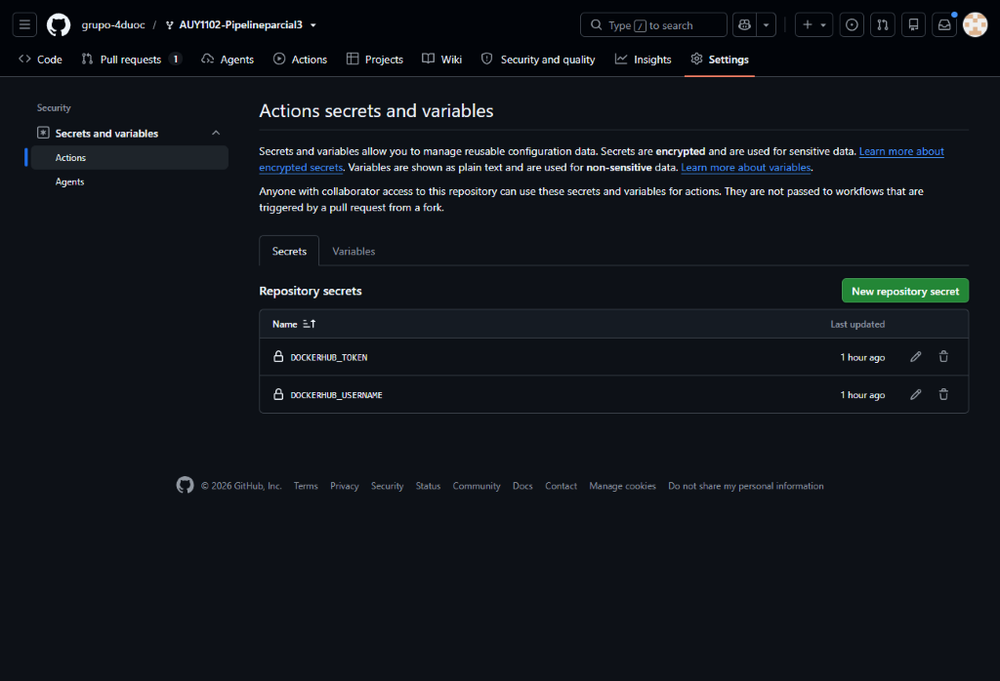

---

## 🚨 7. Evidencia del Bloqueo (Parte 2 - Simón Lagos)

Para demostrar que los gates funcionan, el repositorio contenía **a propósito** código inseguro (`src/quality/`), secretos expuestos (`credentials.yml`, `.npmrc`, `src/index.ts`), dependencias vulnerables y una imagen base sin soporte (`node:18-alpine`). Las siguientes capturas muestran cómo el pipeline **detectó y bloqueó** cada problema.

### 7.1. Pipeline bloqueado (no se publica en Docker Hub)
Ejecución del pipeline tras un `push` a `develop`. Las pruebas unitarias pasan, pero fallan SonarCloud, Snyk, CodeQL, Gitleaks y Docker Scout. Como consecuencia, el job **`Publicar en Docker Hub` queda omitido** (*skipped*) gracias a los `needs`: ninguna imagen insegura llega a Docker Hub.

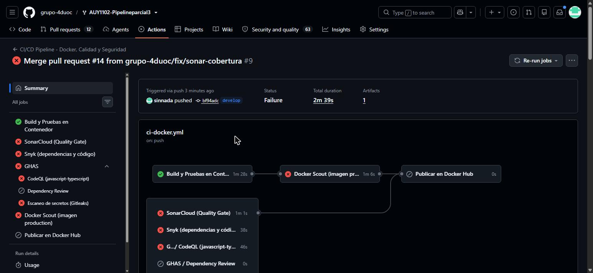

### 7.2. SonarCloud: Quality Gate *Failed*
El Quality Gate **"Sonar way"** de la rama `develop` queda en **Failed**: 21 issues de seguridad (calificación C) y una cobertura de solo **39.6%**, inferior al 80% exigido para código nuevo.

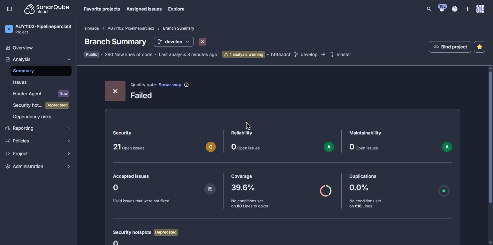

### 7.3. Snyk Code: 2 hallazgos HIGH
`snyk code test` reporta **2 vulnerabilidades HIGH**: un secreto hardcodeado en `src/index.ts` (línea 3) y una *Server-Side Template Injection* en `src/quality/insecure-1-object.ts` (entrada del usuario sin sanitizar enviada a `pug.compile`).

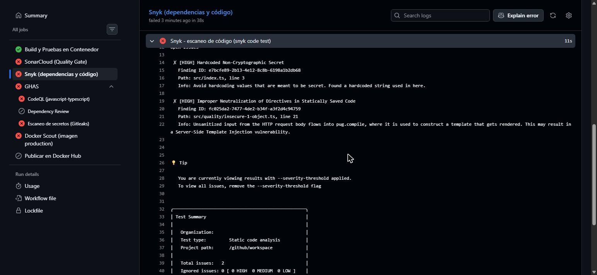

### 7.4. CodeQL: alertas critical y high
*Security → Code scanning* muestra las alertas de CodeQL en `develop`: **Code injection (Critical)** en `src/quality/insecure-1-object.ts` y **Clear-text logging of sensitive information (High)** en `src/quality/insecure-2-object.ts`. El paso de gate del SARIF hace fallar el job.

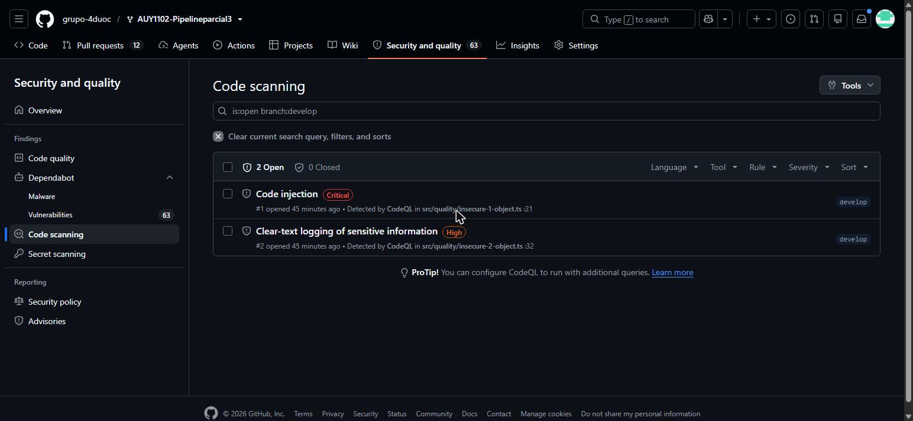

### 7.5. Gitleaks: 5 secretos detectados
El escaneo de secretos encuentra **5 filtraciones** (`leaks found: 5`), entre ellas el token de GitHub en `credentials.yml` (regla `github-fine-grained-pat`) y las variables `apiKey` y `githubToken` hardcodeadas en `src/index.ts` (regla `generic-api-key`).

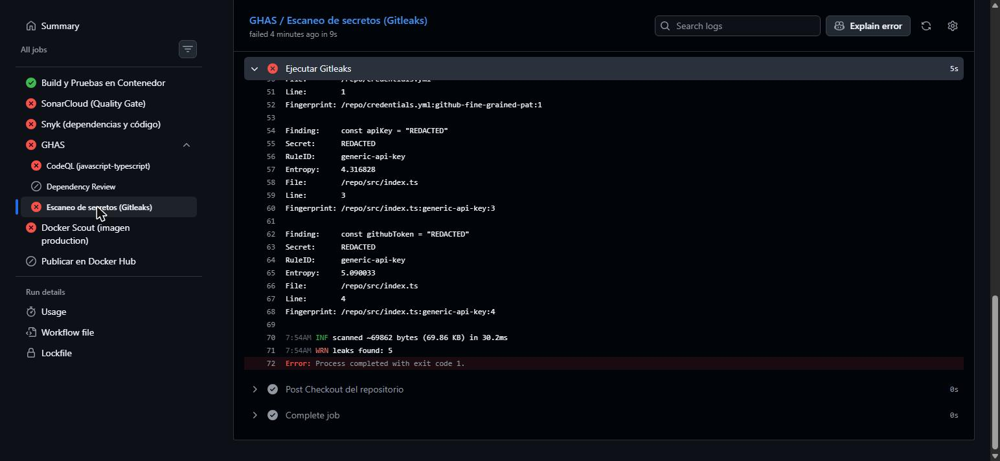

### 7.6. Dependabot: alertas de dependencias vulnerables
Dependabot reporta **63 alertas abiertas** en el `package-lock.json`, incluyendo vulnerabilidades **critical** (por ejemplo, `handlebars`) y **high** (`flatted`, `tar`, entre otras).

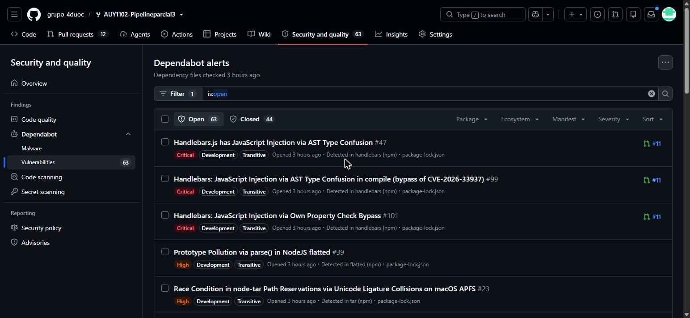

### 7.7. Docker Scout: 7 critical / 45 high en `node:18-alpine`
La imagen `production` construida sobre **`node:18-alpine`** (versión sin soporte) presenta **7 vulnerabilidades critical y 45 high**, por lo que Docker Scout falla con `exit-code: true`.

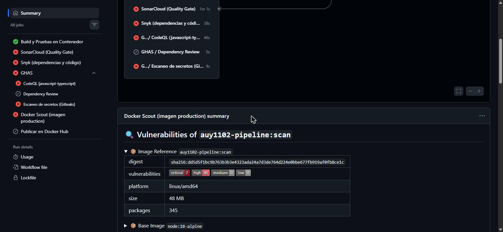

### 7.8. Pull Request `develop` → `main` con merge bloqueado
En el Pull Request hacia `main`, los checks requeridos fallan (*"Some checks were not successful"*) y el botón **"Merge pull request" queda deshabilitado**: el código inseguro no puede integrarse a la rama principal.

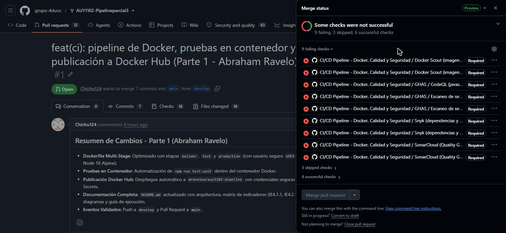

### 7.9. Ruleset `proteger-main` con los 7 checks requeridos
Configuración del Ruleset que protege `main`, exigiendo como *required status checks* los 7 jobs del pipeline (build/pruebas, SonarCloud, Snyk, Docker Scout, CodeQL, Gitleaks y Dependency Review).

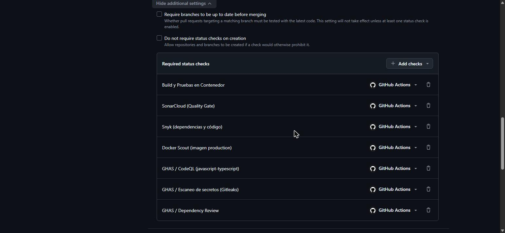

---

## 🔧 8. Remediación

Una vez demostrado el bloqueo, se corrigieron los hallazgos en la rama `fix/remediacion-y-informe`:

| # | Problema detectado | Herramienta que lo detectó | Corrección aplicada |
| :---: | :--- | :--- | :--- |
| 1 | Token de GitHub en `credentials.yml` | Gitleaks, Secret Scanning | Se **eliminó** el archivo. El token debe además **revocarse** en GitHub, ya que permanece en el historial de commits. |
| 2 | `_authToken` hardcodeado en `.npmrc` | Gitleaks | Se eliminó la línea del token. Si se necesita autenticación con GitHub Packages, debe usarse `${NODE_AUTH_TOKEN}` desde un secret. |
| 3 | `apiKey` y `githubToken` hardcodeados en `src/index.ts` | Gitleaks, Snyk Code | Las credenciales ahora se leen desde variables de entorno (`process.env.API_KEY` y `process.env.GITHUB_TOKEN`) mediante `getConfig()`. La consulta solo se ejecuta al correr `node dist/index.js` y no al importar la librería. |
| 4 | Código inseguro de demostración en `src/quality/` (code injection, SQL injection, XSS, credenciales) | CodeQL, Snyk Code, SonarCloud | Se **eliminó** la carpeta y su exclusión en `tsconfig.json` y `.eslintignore`. |
| 5 | Imagen base `node:18-alpine` sin soporte (7 critical / 45 high) | Docker Scout, Dependabot (docker) | `Dockerfile`: `node:18-alpine` → **`node:22-alpine`** (LTS) en todas las etapas, `RUN apk upgrade --no-cache` para aplicar parches de Alpine y eliminación de `npm`/`npx` en la etapa `production` (no se usan en ejecución y arrastran CVEs). |
| 6 | Dependencias de producción vulnerables (`chokidar@2` → `braces`, `decode-uri-component`, etc.) | Snyk, Dependabot | `chokidar` y `cosmiconfig` **no se usaban** en el código, por lo que se eliminaron. `tslib` pasó a `dependencies` porque el código compilado la requiere en tiempo de ejecución. Resultado: `npm audit --omit=dev` → **0 vulnerabilidades**. |
| 7 | Cobertura de 39.6% (Quality Gate exige 80%) | SonarCloud | Se agregaron pruebas unitarias para `DateValueObject`, `src/index.ts` (`getConfig` y `fetchData`) y el caso inválido de `EnumValueObject`. Cobertura local: **98.21%** de líneas (38 pruebas, 12 suites). |

### 8.1. Segunda ronda: Security Rating A en SonarCloud

Tras la primera remediación, SonarCloud seguía exigiendo **Security Rating A en código nuevo** y reportaba 23 issues. Se corrigieron en la rama `fix/gates-verde`:

| # | Problema detectado | Corrección aplicada | Por qué |
| :---: | :--- | :--- | :--- |
| 8 | Actions referenciadas por tag mutable (`@v4`, `@master`) | Todas las actions de los 5 workflows se fijaron a su **commit SHA completo**, con la versión en un comentario (por ejemplo, `actions/checkout@11d5960a… # v4.4.0`). Los SHA se obtuvieron con `git ls-remote`. SonarCloud se actualizó a `sonarqube-scan-action` **v6.0.0** (la v5 ya no tiene soporte) y Snyk de `@master` a la release **v1.0.0**. | Un tag puede moverse a otro commit en cualquier momento. Si el repositorio de una action es comprometido, un tag modificado ejecutaría código malicioso en el pipeline con acceso a los secrets (**ataque a la cadena de suministro**). Un SHA es inmutable. Dependabot (`github-actions`) sigue proponiendo las actualizaciones. |
| 9 | API key enviada en la URL (`?api_key=…`) y respuesta externa registrada con `console.log` | `fetchData()` envía la key en el header **`x-api-key`**. Ya no se registran la respuesta ni el objeto de error; solo mensajes fijos (`'Consulta a la API completada.'`, `'Error al consultar la API.'`). Las pruebas verifican que la key no aparece en la URL y que la respuesta no se registra. | Las query strings quedan guardadas en logs de servidores, proxies e historial, lo que **filtra la credencial**. Registrar datos externos sin sanitizar permite inyección de logs y exposición de información sensible. |
| 10 | Instalación de dependencias con scripts habilitados y fallback `\|\| npm install` | En el `Dockerfile` (etapas `builder` y `production`), el job `sonarcloud` y los workflows legado se usa **`npm ci --ignore-scripts`**, sin fallback. Se verificó localmente que `npm ci --ignore-scripts && npm run build && npm run test:coverage` funciona. | Los scripts `preinstall`/`postinstall` de cualquier dependencia (incluso transitiva) se ejecutan con los permisos del pipeline: es un vector conocido de malware en npm. El fallback `npm install` ignoraba el `package-lock.json` y podía instalar versiones no revisadas; `npm ci` instala exactamente lo bloqueado o falla. |
| 11 | Docker Scout bloqueando por CVEs de paquetes de Alpine | En el paso `docker/scout-action` se agregó **`only-fixed: true`**. | Con `only-fixed: true` el gate bloquea todo CVE critical/high **accionable** (con versión corregida publicada), pero no detiene el pipeline por hallazgos que aún no tienen parche y que el equipo no puede remediar. Esos CVEs siguen visibles en el reporte de Scout para monitorearlos. |

### 8.2. Tercera ronda: cierre de los gates

| # | Problema detectado | Corrección aplicada | Por qué |
| :---: | :--- | :--- | :--- |
| 12 | `npm ci` fallaba en GitHub Actions y Docker (*"package.json and package-lock.json are not in sync"*) | Se regeneró el `package-lock.json` con **npm 10** (`npx -y npm@10 install --package-lock-only --ignore-scripts`) y se verificó con `npm@10 ci` en una carpeta limpia. | El lockfile se había generado con npm 11, que omite la *peer dependency* opcional `typescript` requerida por el `cosmiconfig` anidado de `semantic-release`. Node 22 (pipeline e imagen Docker) usa npm 10, que sí la exige. |
| 13 | CVE de `musl` en la imagen `production` (**CVE-2026-107891**) | En la etapa `production` del `Dockerfile` se instala **`musl` 1.2.6-r6** (y `musl-utils`) desde el repositorio **Alpine edge** (`apk add --upgrade ... --repository=.../alpine/edge/main`). | La versión corregida solo está publicada en Alpine edge: **Alpine 3.24 todavía trae la 1.2.6-r3**, vulnerable. Como existe un arreglo, `only-fixed` lo considera accionable y el gate lo bloquea con razón; instalar el paquete parcheado elimina la vulnerabilidad sin esperar la siguiente versión de la imagen base. |
| 14 | Job de Docker Scout fallaba al intentar comentar en el Pull Request | Se agregó **`write-comment: false`** al paso `docker/scout-action`. | Por defecto, Scout intenta publicar un comentario con el resumen en el PR, lo que requiere el permiso `pull-requests: write`. El pipeline trabaja con permisos mínimos (`contents: read`), por lo que el comentario fallaba y hacía fallar el gate por un motivo ajeno a la seguridad. El resultado del escaneo sigue disponible en el resumen del job. |
| 15 | Falso negativo aleatorio en `differentTo.test.ts` | La prueba se corrigió igual que `equalsTo.test.ts`: el valor "distinto" se construye como `name + 'x'`, garantizando que nunca coincida con `name`. | La prueba generaba dos palabras aleatorias independientes con `WordMother`; a veces coincidían y la prueba fallaba sin que el código tuviera errores. Una prueba no determinista bloquea el pipeline sin motivo y resta confianza en los gates. |

---

## ✅ 9. Evidencia del Pipeline Aprobado

Tras la remediación, el mismo pipeline que antes bloqueaba ahora aprueba todos los gates y publica la imagen.

### 9.1. Pipeline completo en verde y publicación en Docker Hub
Ejecución #19 del pipeline tras un `push` a `develop`: **todos los jobs terminan en verde** (Build y Pruebas, SonarCloud, Snyk, GHAS y Docker Scout) y, como todos los `needs` se cumplen, el job **`Publicar en Docker Hub` se ejecuta y publica la imagen**. `Dependency Review` aparece omitido porque solo corre en Pull Requests.

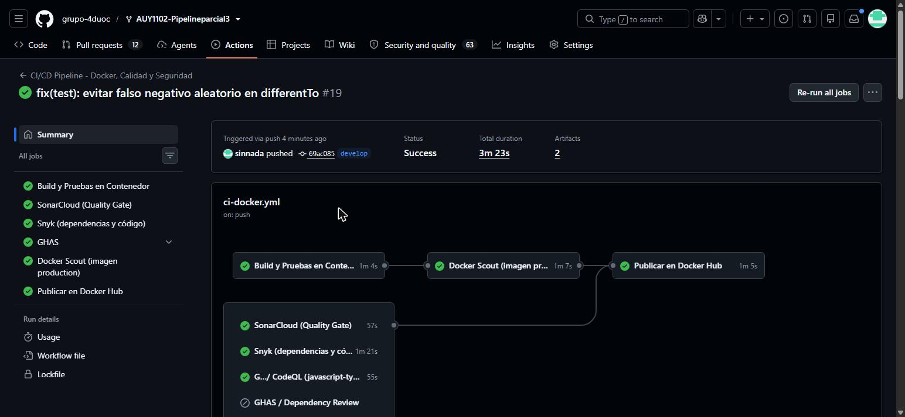

### 9.2. SonarCloud: Quality Gate *Passed*
El Quality Gate **"Sonar way"** de `develop` pasa a **Passed**: **0 issues nuevos**, **91.3% de cobertura** en código nuevo (mínimo exigido: 80%) y 0.0% de duplicación (máximo: 3%).

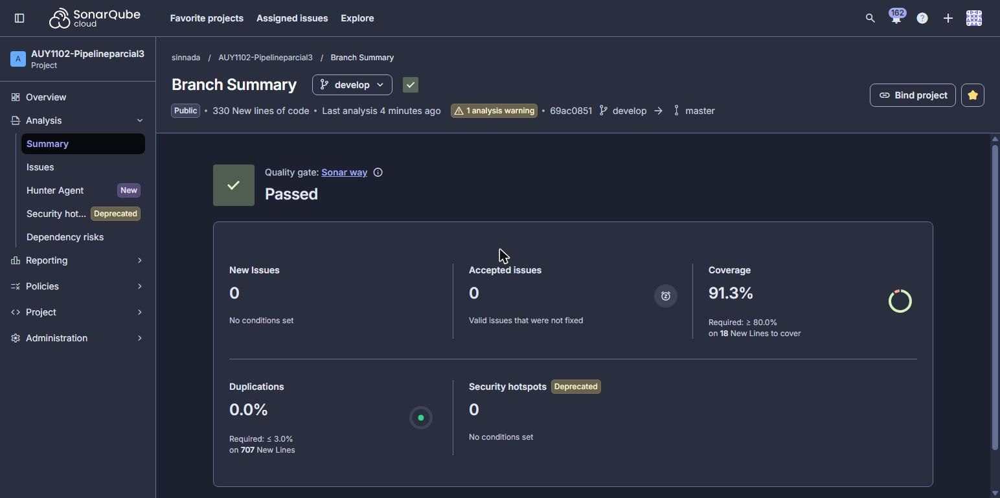

### 9.3. Pull Request `develop` → `main` habilitado para merge
El [Pull Request #1](https://github.com/grupo-4duoc/AUY1102-Pipelineparcial3/pull/1) hacia `main` muestra **"All checks have passed"** (15 exitosos, 2 omitidos) y sin conflictos: el Ruleset `proteger-main` ahora **permite el merge**, porque todos los checks requeridos están en verde.

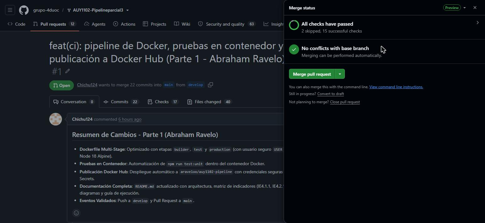
